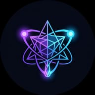

&#x20;

\# IOSA

\## IMMANG Orchestra Software Agency

\### Autonomous AI-Powered Software Engineering System

\*\*From Ideas to Live Applications.\*\*

\---

IOSA (IMMANG Orchestra Software Agency) adalah proyek pengembangan sistem Software Engineering berbasis Artificial Intelligence (AI) yang dirancang untuk mengotomatisasi proses pembangunan perangkat lunak secara menyeluruh, mulai dari sebuah ide hingga menjadi aplikasi yang siap digunakan secara online.

IOSA mengusung konsep \*\*Multi-Agent System\*\*, yaitu sebuah arsitektur yang mengintegrasikan berbagai AI Agent dengan peran dan tanggung jawab berbeda ke dalam satu sistem orkestrasi yang terkoordinasi.

Melalui IOSA, Owner cukup memberikan ide, kebutuhan, atau instruksi mengenai aplikasi yang ingin dibangun. Sistem kemudian bertugas mengelola tahapan pengembangan secara terstruktur, mulai dari analisis kebutuhan, perencanaan sistem, perancangan UI/UX, pengembangan frontend dan backend, pengelolaan database, pengujian, perbaikan kesalahan, hingga deployment ke lingkungan online.

Tujuan akhirnya adalah menghasilkan aplikasi web maupun mobile yang tidak hanya selesai dibuat, tetapi juga dapat diakses dan digunakan oleh pengguna secara nyata.

\---

\## Vision

Membangun sebuah Autonomous Software Engineering System yang mampu mengubah ide menjadi produk digital melalui proses pengembangan perangkat lunak yang terintegrasi, terkoordinasi, dan semakin mandiri.

IOSA dikembangkan untuk menjadi sistem yang tidak hanya membantu menulis kode, tetapi juga mampu memahami kebutuhan, mengambil langkah pengembangan, mengevaluasi hasil pekerjaan, serta mengelola proses pembangunan aplikasi dari awal hingga siap digunakan.

\## Mission

1\. Mengembangkan sistem orkestrasi AI Agent untuk mengelola proses Software Engineering.

2\. Mengotomatisasi analisis kebutuhan dan perencanaan proyek.

3\. Mengembangkan kemampuan pembuatan aplikasi web dan mobile.

4\. Mengintegrasikan proses frontend, backend, database, dan API.

5\. Membangun sistem pengujian dan perbaikan kode otomatis.

6\. Mengembangkan kemampuan deployment agar aplikasi dapat digunakan secara online.

7\. Menciptakan sistem pengembangan perangkat lunak yang modular, aman, dan berkelanjutan.

\## Core Workflow

IOSA dirancang untuk menjalankan siklus pengembangan perangkat lunak berikut:

| Tahapan | Proses |

|---|---|

| 01. Idea Analysis | Memahami ide dan menganalisis kebutuhan |

| 02. System Planning | Menyusun spesifikasi dan arsitektur sistem |

| 03. UI/UX Design | Merancang antarmuka dan pengalaman pengguna |

| 04. Development | Membangun frontend, backend, database, dan API |

| 05. Testing | Menguji kualitas dan fungsionalitas aplikasi |

| 06. Auto Repair | Mendeteksi dan memperbaiki kesalahan |

| 07. Deployment | Mempublikasikan aplikasi ke lingkungan online |

| 08. Delivery | Menyerahkan aplikasi yang siap digunakan |

\## Multi-Agent Architecture

IOSA menggunakan pendekatan Multi-Agent System. Setiap Agent memiliki tanggung jawab khusus dan bekerja di bawah koordinasi IOSA Engine.

Komponen utama yang dikembangkan:

\- \*\*IOSA Orchestrator\*\* — Pusat koordinasi dan pengendali alur kerja.

\- \*\*AI Brain\*\* — Menghubungkan sistem dengan model kecerdasan buatan.

\- \*\*Analyst Agent\*\* — Menganalisis instruksi dan kebutuhan proyek.

\- \*\*Developer Agent\*\* — Mengembangkan kode dan membangun aplikasi.

\- \*\*Tester Agent\*\* — Memeriksa dan menguji hasil pengembangan.

\- \*\*Memory System\*\* — Mengelola informasi dan riwayat pekerjaan.

\- \*\*Workspace Manager\*\* — Mengelola file dan lingkungan kerja proyek.

Arsitektur ini dirancang agar dapat diperluas dengan Agent baru sesuai kebutuhan pengembangan IOSA.

\## Target Capabilities

IOSA memiliki target kemampuan jangka panjang:

\- Automated Requirement Analysis

\- Automated System Planning

\- AI-Powered UI/UX Design

\- Automated Web Development

\- Automated Mobile App Development

\- Backend and Database Engineering

\- API Integration

\- Automated Software Testing

\- Automated Code Repair

\- Automated Deployment

\- Application Monitoring and Maintenance

\## Development Principles

Pengembangan IOSA berpedoman pada prinsip:

\- Understand First

\- Analyze Before Design

\- Design Before Build

\- Modular Development

\- Verify Everything

\- Security First

\- Human Control

\- Continuous Improvement

\## Technology Stack

Teknologi yang digunakan dan direncanakan dalam pengembangan IOSA meliputi:

\- \*\*Python\*\* — Bahasa pemrograman utama sistem.

\- \*\*Google Gemini API\*\* — Integrasi kecerdasan buatan.

\- \*\*Git \& GitHub\*\* — Version control dan pengelolaan kode.

\- \*\*Web Technologies\*\* — Pengembangan aplikasi berbasis web.

\- \*\*Mobile Technologies\*\* — Pengembangan aplikasi mobile.

\- \*\*Cloud Infrastructure\*\* — Hosting dan deployment aplikasi.

\## Project Roadmap

Pengembangan IOSA dilakukan secara bertahap:

\- \[x] IOSA Engine Foundation

\- \[x] AI Brain Integration

\- \[x] Analyst Agent

\- \[x] Developer Agent

\- \[x] Basic Tester Agent

\- \[x] Workspace Management

\- \[ ] Advanced Software Testing

\- \[ ] Automated Code Repair

\- \[ ] Intelligent Project Planning

\- \[ ] UI/UX Design Agent

\- \[ ] Automated Web Application Development

\- \[ ] Automated Mobile Application Development

\- \[ ] Database and API Engineering

\- \[ ] Automated Deployment System

\- \[ ] Application Monitoring and Maintenance

\- \[ ] Full Software Engineering Orchestration

\## Project Status

\*\*Current Status: Early Development\*\*

IOSA masih dalam tahap pengembangan fondasi sistem. Beberapa kemampuan dasar seperti analisis instruksi, pembuatan file program, dan pemeriksaan syntax Python telah mulai diimplementasikan.

Kemampuan pengembangan aplikasi secara menyeluruh hingga deployment online merupakan target pengembangan berikutnya, bukan kemampuan yang sudah sepenuhnya tersedia saat ini.

\---

\## Project Identity

\*\*Project Name:\*\* IOSA  

\*\*Full Name:\*\* IMMANG Orchestra Software Agency  

\*\*Category:\*\* AI-Powered Software Engineering  

\*\*Architecture:\*\* Multi-Agent System  

\*\*Primary Language:\*\* Python  

\*\*Development Approach:\*\* Autonomous Software Engineering

\### IOSA

\*\*From Ideas to Live Applications.\*\*

\*Orchestrating Intelligence. Engineering Possibilities.\*

